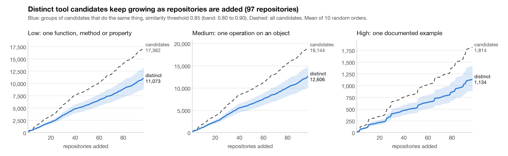

# A4A: Anything for Agents

**From a source of information to verified tasks and tools for LLM agents, with a measurement of whether they help a model.**

A4A takes a source of information and extracts things a model can be trained and tested on: tools it can call, and tasks with known answers. An LLM proposes them; a program runs each one and keeps only what it could check.

| Source | What is extracted | How it is checked | Command |
| --- | --- | --- | --- |
| A Python repository (its code) | Tools, one per library function | The tool gives the same result as calling the library directly, in a sandbox | `a4a generate` |
| The repository's documentation | Exercises and questions with known answers | Two sandboxed runs of the documentation example give the same value, and a second model can solve the question from its wording | `a4a corpus-exercises`, `a4a corpus-tasks` |
| A SQLite database | Exercises: queries over its tables, made from templates over the schema | Two sandboxed runs of the query give the same value | `a4a db-fetch`, `a4a db-exercises` |

These three kinds of source are what is implemented today. Other kinds (websites, PDFs) are not. The commands that make and measure exercises reach a source only through a small interface (`src/a4a/sources/base.py`): its text by part, the elements it offers, its candidate exercises, and its sandbox. A new kind of source is a new class there.

The command is `a4a`. Its first part, **repo2tools**, is the one that turns a repository into tools (`src/a4a/repo2tools/`, command `a4a generate`): it takes the URL of a Python library, has an LLM write one tool per library function, and accepts a tool only if running it gives the same result as calling the library directly. It then works out which tools can be chained, again by running them, and measures what a model does with the tools: how often it solves tasks with known answers, and what a run costs in tokens.

<p align="center">
  
</p>
<p align="center"><sub><b>Figure 1.</b> Overview. <i>Top:</i> tool synthesis. An LLM writes each tool, and a sandboxed verifier accepts it only if it agrees with the library on sample inputs. <i>Bottom:</i> the types an LLM proposes are kept only where the tools, when run, accept each other's values (T<sup>kept</sup>); the typed tools feed ToolGym's chain sampling and an agent evaluation, and both produce traces for analysis.</sub></p>

Research prototype from the Tool-Gym track of the project *Agentic Reasoning, Tooling* at the University of Bern.
Author: Kobiljon Muhammadov. Supervisor: Roman Macháček.

## Contents

- [The question](#the-question)
- [What is in the box](#what-is-in-the-box)
- [Results at a glance](#results-at-a-glance)
- [Quick start](#quick-start)
- [Stage 1: from a repo link to tools](#stage-1-from-a-repo-link-to-tools)
- [Many repositories: the candidate list](#many-repositories-the-candidate-list)
- [Databases as a source](#databases-as-a-source)
- [Memory or skill?](#memory-or-skill)
- [Training a small model on the verified tasks](#training-a-small-model-on-the-verified-tasks)
- [Public benchmarks: does training help or hurt elsewhere?](#public-benchmarks-does-training-help-or-hurt-elsewhere)
- [Usability: can a small model call the tools](#usability-can-a-small-model-call-the-tools)
- [Stage 2: chains and synthetic traces with ToolGym](#stage-2-chains-and-synthetic-traces-with-toolgym)
- [Stage 3: exercises, traces and repetition](#stage-3-exercises-traces-and-repetition)
- [What each check can and cannot tell](#what-each-check-can-and-cannot-tell)
- [Limitations](#limitations)
- [Repository layout](#repository-layout)
- [Reproducing the results](#reproducing-the-results)
- [Related work](#related-work)

## The question

Coding agents are trained and evaluated with tool interfaces that people wrote by hand. The project asks whether **automatically generated tools, tasks and agent traces** can do the same job. That only works if generated artifacts can be trusted, so the design rule of this repository is:

> An LLM may propose anything. Nothing is kept unless a program has run it and checked it.

Three things follow from that rule, one per stage:

1. **A tool is correct if it agrees with the library it wraps.** The library is the oracle: no hand-written expected values.
2. **A type is correct if its values are interchangeable.** Two parameters share a type only if each accepts the other's values when the tools are run.
3. **A measurement needs known answers.** The exercises take their answers from the library's own test suite, so the score never depends on the tool set being tested.

## What is in the box

| Stage | What it does | Entry point |
| --- | --- | --- |
| 1. Synthesize | Clone a repo at a recorded commit, scan its public API without running it, generate tools, verify them in a sandbox, repair on failure | `a4a generate` |
| 2. Chain | Give the tools semantic types checked by execution, load them into ToolGym, run its live chain check and its data-generation pipeline | `a4a toolgym-types`, `a4a toolgym-local` |
| 3. Measure | Run a model on exercises with and without tools; save every request as a trace; quantify repetition and simulate context compression | `a4a run-model`, `a4a analyze-traces` |

Also included: 21 reference tools over [pypa/packaging](https://github.com/pypa/packaging) that were written before the pipeline existed (called "hand-made" below, as the baseline the generated tools are compared with), 242 exercises with known answers, and a test suite of over 100 tests that needs no GPU and no API key.

## Results at a glance

<p align="center">
  
</p>
<p align="center"><sub><b>Figure 2.</b> <i>Left:</i> exercises solved by Qwen3-8B with each tool set. <i>Right:</i> where the prompt tokens of a run go.</sub></p>

All numbers are first results: small models, one run per setting, one library. Each one can be rebuilt from the files in `out/`.

- **Generated tools match hand-made ones where a fitting tool exists, and lose where none was generated.** On the 82 exercises with a fitting generated tool: 74 solved against 72 with hand-made tools. On the other 140: 49 against 137. The gap is in *which* functions get turned into tools, not in the quality of the tools. (The 82 were identified after seeing the results.)
- **Offering unsuitable tools can be worse than offering none.** With 22 generated tools the model solves 44% of the exercises, below the 60% of the run without tools (an earlier run, whose system prompt also differs slightly).
- **Passing every check does not make a tool usable.** `check_specifier_set_unsatisfiable` is correct, but asked whether a constraint *can* be satisfied, the model copies its `true` (at most 1 of 20 solved). Eight range tools return text that no other tool accepts.
- **Types checked by execution give ToolGym chains that survive its validation:** 11 of 33 short chains accepted, against 0 of 15 with hand-written types, whose chains run through automatic casts.
- **Long chains need a richer graph, not more steps.** The longest chain in which every tool appears once has 4 calls for the generated tools and 8 for the hand-made ones, so a random walk of 8 to 10 steps can only go in circles (201 of 201 did). Long tasks in practice repeat a short pattern over many items.
- **Worked examples in the prompt did not unlock long tool use.** With known-good solutions of similar tasks as examples, Qwen3-8B still solves 0 of 18 long tasks; Qwen3-32B makes more of the right calls (7.2 per run, up from 3.5) but solves 2 of 18.
- **The tool list dominates the prompt.** It is 60% to 97% of all prompt tokens when 21 or more tools are offered. Sending only the 5 most relevant tools (with a perfect retriever) would save 44% to 81%. Trimming old tool outputs saves 0% to 3% in those runs, but 20% on ToolGym's long chains, where outputs are long lists.
- **Forcing tool calls yields more calls, not better ones.** Forced on every step, all 20 long runs call tools (6 of 20 otherwise), 2 pass, and 250 of 502 calls repeat an earlier call exactly.

<details>
<summary><b>All result tables</b></summary>

Qwen3-8B served with vLLM on an RTX 4090, 30 October 2026, temperature 0, one run per exercise. Details in `out/runs/`.

| Exercises | With tools | Without tools |
| --- | --- | --- |
| Short (222, 1 tool call) | 94% | 60% |
| Long (20, 10 to 23 tool calls) | 0 of 20 | 0 of 20 |
| Long, model may think first | 12 of 20, with 0 tool calls | 10 of 20 |

The same 20 long tasks with tools of different sizes (thinking off):

| Tool set | Calls a task needs | Passed |
| --- | --- | --- |
| 21 small tools | 10 to 23 | 0 of 20 |
| 1 tool per requirement line | 4 to 6 | 1 of 20 |
| 1 tool for the whole task | 1 | 16 of 20 |
| All 23 together | 1 | 16 of 20 |

These are first results: one small model, one run, and 20 long tasks of one kind.

Generated tools, 6 November 2026. Qwen3-Coder-30B writes the tools, and Qwen3-8B uses them on the 222 short exercises:

| Tool set | Tools | Passed |
| --- | --- | --- |
| Hand-made (run again; same score as in October) | 21 | 94% (209) |
| No tools (October run) | 0 | 60% (133) |
| Generated, `--max-tools 60` (the LLM picked 39, 29 accepted) | 29 | 55% (123) |
| Generated, `--max-tools 30` (22 accepted) | 22 | 44% (98) |

- **Where a fitting tool exists, generated tools match hand-made ones:** 74 vs 72 of 82 exercises. These six exercise kinds were chosen after seeing the results.
- **The main gap is choosing tools:** on the other 140 exercises it's 49 vs 137. The LLM skipped most `Version` tools, and the library has no public function to compare two versions, because that is done with operators.
- **A correct tool can still be misused:** `check_specifier_set_unsatisfiable` passes every check, but the model copies its `true` when asked whether a constraint *can* be satisfied (0 of 20).
- **The comparison favours the hand-made tools:** they were written together with these exercises.

Traces of real runs, Qwen3-8B. All numbers are in `out/traces/analysis/repetition.md`:

| Long tasks (20) | Runs with a tool call | Passed | Calls | Exact repeats |
| --- | --- | --- | --- | --- |
| The model decides | 6 | 0 | 49 | 4 |
| First request must call a tool | 20 | 0 | 106 | 5 |
| Every request must call a tool | 20 | 2 | 502 | 250 |

Forcing gets more calls, but not better ones: one run called `evaluate_marker` 38 times with the same arguments. These traces need filtering before anyone trains on them.

Generated tools in ToolGym, 11 November 2026. Qwen3-32B proposes the types and runs ToolGym's pipeline (as writer, judge and challenger). One run each:

| | Generated tools (29, packaging) | Hand-made tools (21) |
| --- | --- | --- |
| Type links between tools | 16, all checked by running them | 144 by ToolGym's rules, of which 62 are noise |
| ToolGym live `chain_check` | 16 of 16 chains pass | not run |
| Short chains (2 to 4 calls): sampled, finished, accepted by ToolGym's validation | 40, 33, **11** | 40, 15, **0** |
| Long chains (8 to 10 calls): sampled, finished, accepted | 20, 12, **0** | 20, 8, **0** |

- **Checked types give usable short chains.** Hand-typed tools get chains through ToolGym's automatic casts (a package name fed into a specifier check), and its validation rejects all of them.
- **Long chains are not solved by asking for more steps.** With 16 links, a long walk loops: one chain is `parse_tag` eight times, and 34 of 104 calls repeat an earlier call exactly.
- **The check finds tools that cannot be chained.** Eight range tools take a constraint like `>=1.0` but return text like `<VersionRange '[1.0, 2.0.dev0)'>`, which no tool accepts. They passed every check of `a4a generate`.
- **A harder repo:** more-itertools gives 50 accepted tools of 142 picked. Its values are plain lists, so the LLM found only 2 types and 21 links. Kinds of values work for a domain library like packaging, not for generic data.

Chaining, 12 November 2026. Qwen3-32B repairs and types the tools and runs ToolGym; Qwen3-8B is the second model. One run each, small numbers.

| Step | Result |
| --- | --- |
| Dead-end tools repaired (`a4a repair-chains`) | 3 of 8. One more "repair" passed the library check and the consumer check but returned `""` for every union of ranges; a third guard (different results must stay different) rejected it |
| Links between the 29 generated tools, same type claims before and after | 45 before, 69 after; tools with no link: 16, then 8. ToolGym's live chain check: 44 of 44, then 86 of 86 |
| Hand-made tools with checked types instead of hand-written ones | 49 links; short chains accepted by ToolGym: 11 of 26 (hand-written types: 0 of 15) |
| Longest chain in which every tool appears once | 4 calls (generated, before and after repair), 8 (hand-made), 3 (more-itertools) |
| Chains of 8 to 10 calls from ToolGym's uniform walk | 201 of 201 sampled chains call a tool twice or more; 199 call one twice in a row |
| Walk to the least visited step instead (`--spread-walk`) | 45 chains of 4 to 6 calls with all tools different and no repeated call; none of 8 or more, because the graphs have no such path |
| ToolGym tasks as exercises for a second model (answer = output of the last call) | Hand-made tools: 11 of 25 with tools, 7 of 25 without. Generated tools: 16 of 37 with, 18 of 37 without. 19 of 25 true/false answers are right without any tool |
| Tasks ToolGym accepted against tasks it rejected, solved by the second model with tools | 13 of 27 against 14 of 35 |
| 20 long exercises with worked examples in the prompt, Qwen3-8B | No examples: 0 of 20. Three ToolGym chains: 0 of 20, and no run calls a tool. Two known-good solutions of other long tasks: 0 of 18, 1.9 calls of 17 needed |
| The same with Qwen3-32B | No tools 4 of 20; tools 2 of 20; ToolGym chains 2 of 20 (0.8 calls per run); known-good solutions 2 of 18 (7.2 calls per run, 11 runs use every needed tool) |

Usability, 12 November 2026. Qwen3-8B uses the 29 generated packaging tools; Qwen3-32B writes the tasks (135, one per checked sample call) and the new descriptions. One run; a second run of the same measurement differed by 1 or 2 tasks.

| | Before | After the rewrite |
| --- | --- | --- |
| Right call with only the tool offered, all 135 tasks | 112 (83%) | 123 (91%) |
| Right call with all 29 tools offered, all 135 tasks | 104 (77%) | 116 (86%) |
| The same on the 58 held-out tasks: tool alone, whole set | 44, 43 | 49, 48 |
| Held-out tasks of the 9 rewritten tools, both settings | 22 of 40 | 32 of 40 |
| Held-out tasks of the 20 other tools, both settings | 65 of 76 | 65 of 76 |
| 222 short exercises with known answers | 124 (56%) | 127 (57%) |

- **Before the rewrite the model picks or calls a generated tool wrongly about one time in five.** In the whole set the main failure is choosing a similar tool (18 of 31 failures): `check_specifier_sets_disjoint` loses all five of its tasks to `check_version_ranges_disjoint`.
- **Rewriting descriptions helps on the tools' own tasks and does not carry over to the exercises.** 124 to 127 of 222 is inside the run-to-run difference (two runs of the old set differed on 3 exercises).
- **Where the exercise score is lost** (old set, hand-made tools in brackets): the needed function is wrapped directly, 76 of 82 (72); a tool could answer but not directly, 16 of 60 (59); the function is not wrapped, 32 of 80 (78). In the last two groups the generated tools score below no tools at all (33 and 54), because a similar tool attracts the call.
- **A rewrite can make a description false.** In a first run the rewriter copied the library's return type ("returns a Version object") for tools that return text, and the exercise score fell to 117. The rewriter is now told what the tool returns, and a rewrite is dropped if the model's final answer matches the tool's result less often.
- **Not fixed by words:** no rewrite helped `check_specifier_sets_disjoint` (a duplicate of another tool) or `generate_compatible_tags` (its output overflows the model's context).

</details>

## Quick start

Needs [uv](https://docs.astral.sh/uv/). `uv run` installs the package and its dependencies on first use, and `uv run a4a --help` lists every command.

This replays a known-good solution for every exercise through the tools:

```sh
uv run a4a check-tools out/packaging/exercises.jsonl -- uv run python toolsets/pypa_packaging/server.py
```

The last line should say `242/242 exercises solved by their reference calls`.

To run a model, start an OpenAI-compatible server with tool calling. `cluster/README.md` shows how on UBELIX. Then:

```sh
export OPENAI_API_KEY=<the server's key>
uv run a4a run-model out/packaging/exercises.jsonl --mode tools --base-url http://127.0.0.1:18000/v1 --model qwen3-8b -- uv run python toolsets/pypa_packaging/server.py
uv run a4a run-model out/packaging/exercises.jsonl --mode none --base-url http://127.0.0.1:18000/v1 --model qwen3-8b
uv run a4a compare-runs out/runs/qwen3-8b-tools.jsonl out/runs/qwen3-8b-none.jsonl
```

## Stage 1: from a repo link to tools

```sh
uv run a4a generate https://github.com/pypa/packaging --commit c1d2a9d \
    --base-url http://127.0.0.1:18000/v1 --model qwen3-8b
```

It clones the repo at a recorded commit, finds the package (`src/` layout or top level), and scrapes its public API. An LLM picks up to `--max-tools` functions, naming each by its full path, which must be in the API. Then it writes a test and the code, one tool per library function. Each tool must pass these checks, with errors going back to the LLM for a few repair rounds (`--repair-rounds`):

| Check | What it means |
| --- | --- |
| `static` | Read without running: one public function, type hints, a docstring, no dangerous imports |
| `loads` | The file imports |
| `fastmcp` | FastMCP accepts it, with the agreed parameters |
| `runs` | It runs on the sample inputs; bad input gives `ValueError`, not a crash |
| `differential` | Same result as a direct library call on the same input |

The result goes to `toolsets/generated/<repo>-<model>/` (one file per tool, `server.py`, `run_server.sh`, `manifest.json`) and `out/generated/<repo>-<model>/` (`report.md`, `api.json`, and `llm_log.jsonl` with every LLM request). First version: pure-Python libraries, one tool per function.

**Limits of the checks.** The same model writes the tool and the direct call it is compared with, in separate requests, so the two can share a misunderstanding of the library. The check also sees only what the sample inputs reach: a tool that drops a requirement's extras passes if no sample has extras. And passing says nothing about whether a model can use the tool, or whether the right functions were chosen. A real score needs exercises with known answers.

**Untrusted code.** Repo code and generated code run only in their own environment under `.cache/envs/`:

- Only repos you name are cloned. The repo is never built or installed: its dependencies come as wheels (`--no-build`), and the package is copied in, so no `setup.py` runs.
- Generated code gets an empty environment, so no API keys.
- On macOS it runs inside `sandbox-exec`: no network, no reading the home folder (SSH keys, the API key), writing only to one scratch folder. `tests/test_a4a.py` runs hostile code to check this.
- Other systems have no such sandbox. The tool then warns, and the report says so. Only use repos you trust there.

To score generated tools on exercises, use `a4a run-model` with `run_server.sh` as the server command. `a4a check-tools` needs the hand-made tool names, so it doesn't work on generated tools.

### Which functions to wrap: how the repo itself uses its API

By default the LLM picks functions from a plain list of the public API. Two options give it more to go on:

```sh
uv run a4a usage out/generated/packaging-coder-60/api.json .cache/repos/packaging \
    --package-dir .cache/repos/packaging/src/packaging -o out/usage/packaging.json
uv run a4a generate https://github.com/pypa/packaging --commit c1d2a9d \
    --base-url http://127.0.0.1:18000/v1 --model qwen3-coder --usage docs --classes
```

- `a4a usage` counts how often each API function is used in the repo's own documentation (doctest lines, code blocks, docstring examples) and in its tests. It only reads the files with `ast`; nothing is run. It also counts, per class, how often the class is built and which operators (`<`, `==`, `in`, `&`, ...) are used on its objects.
- `--usage docs|tests|both` sorts the list shown to the LLM by these counts and prints the counts next to each entry.
- `--classes` adds each class as an entry. A class may be picked several times, once per operation, so a tool can wrap `Version(a) < Version(b)` or `version in SpecifierSet(spec)`, which no single function offers.

On packaging (28 doc files, 35 test files, 92 API functions): 64 functions appear in the docs and 86 in the tests. The most used things are not functions at all: `Version` is built 64 times in the docs and 680 times in the tests, and operators are used on its objects about 350 times (mostly `in`, `==`, `<`, `not in`, `>`). 5 of the 13 exercise kinds (100 of 222 exercises) need exactly that, and a function-only list cannot offer it.

`--usage tests` and `--usage both` are **circular** for the packaging exercises, because the exercises are built from the same tests. `--usage docs` is the independent signal.

A third option, `--operators`, lists each operator the repo uses with a class (`Version <`, `SpecifierSet &`, ...) as its own entry, named like its method (`packaging.version.Version.__lt__`). The test of such a tool must use the operator itself.

**Picking, 13 November 2026.** Qwen3-Coder writes the tools (`--max-tools 60`), Qwen3-8B solves the 222 short exercises. Every run is a new tool set from the same commit. For comparison: no tools 133, hand-made tools 209.

| Options | Tools accepted | Exercises solved, per run | Mean |
| --- | --- | --- | --- |
| none (the LLM picks from a plain list) | 31, 31, 30 | 126, 125, 125 | 125 |
| `--usage docs` | 39, 39, 38 | 138, 135, 137 | 137 |
| `--classes` | 39, 37, 38 | 149, 146, 163 | **153** |
| `--usage docs --classes` | 42, 43, 41 | 127, 137, 120 | 128 |
| `--usage both --classes` (circular) | 46 | 127 | |
| `--operators` | 41 | 103 | |
| `--classes --operators` | 45 | 108 | |
| `--usage docs --operators` | 33 | 107 | |
| `--usage docs --classes --operators` | 48 | 124 | |

- With `--classes`, all three runs beat the plain pick and the run without tools. The gain comes from tools for the parts of a version: `version_base` goes from 10 to 20 of 20 and `version_is_prerelease` from 4 to 20 of 20. The same two tools appear with `--usage docs`.
- With `--classes` the LLM picks each class once and makes a constructor tool (`create_version`). It never made a comparison tool, although the prompt allows several tools per class.
- `--usage docs` drops `parse_wheel_filename`, which the docs never call: `wheel_tags` falls from 8 to 0 of 8 in all eight runs with that option. Usage in the docs is a useful hint, not a full ranking.
- `--operators` does give comparison tools (`version_less_than`, `version_equality`, ...; `version_compare` 12 of 20 in one run, against 6 to 9), but up to 18 operator tools push out others and the total falls. Six small comparison tools are a worse fit than the one `compare_versions` of the hand-made set. That is a question of tool size, not of picking.
- One run each for the last five rows, and the model that picks is not deterministic, so read those as single observations.

## Many repositories: the candidate list

The experiments on tool granularity run over many libraries. Which ones is decided by a list that a person approves:

```sh
uv run a4a corpus-candidates --scan 600 --want 100
```

It reads the public list of the most downloaded PyPI packages and PyPI's description of each newest release. Nothing is cloned, and no package code is downloaded or run. A package is a candidate if its wheels are pure Python, its source archive is at most 5 MB and it names a GitHub repository; type stubs are left out, and a repository counts once. From the 600 most downloaded packages (list of 1 November 2026): 100 candidates kept, 281 more would qualify, 126 have compiled code, 33 name no GitHub repository, 27 share a repository with a kept one, 22 are too large, 10 are stubs. The list is in `out/corpus/candidates.md`.

### The static pass

```sh
uv run a4a corpus-scan --jobs 6
```

For each approved repository it clones the default branch (hooks off, no LFS, no submodules), records the commit, and reads the files with `ast`: files and lines, the public API with re-exports followed, how the repository's own documentation and tests use that API, and each documentation example with what it uses. No repository code is run, and links that leave the checkout are not followed. It takes about two and a half minutes for 100 repositories once they are cloned.

Tool candidates are counted at three levels of granularity:

| Level | One tool is | Candidates in 97 repositories | Median per repository | Used in the repository's own docs |
| --- | --- | --- | --- | --- |
| low | one public function, method or property | 17,362 | 54 | 2,150 (12%) |
| medium | one operation on an object: build it, read its properties, call one method, or one family of operators | 19,144 | 59 | 2,451 (13%) |
| high | one documented example that uses two or more things of the API | 1,814 | 2 | all, by definition |

Read on 15 November 2026: 97 of 100 repositories scanned, 1,248,695 lines of code. Three are monorepos where no package was found. 19 repositories have no documentation example that uses their API in a way the scan can read. The table per repository is in `out/corpus/static.md`.

What these numbers are and are not:

- They are counts of **candidates**, read from the code. No tool was generated, so nothing here says a candidate would pass the checks.
- "Used in the docs" is a stand-in for useful. It misses what the docs never show (on packaging: the wheel parser) and what the scan cannot read (docs kept outside the repository, examples in other formats).
- The same thing in two repositories counts twice. Counting distinct tools across repositories is the next section.
- A static scan sees only what is written out: functions made at run time, lazy imports through `__getattr__`, and classes without public methods are missed.

### Do the distinct tools saturate?

```sh
uv run --group analysis a4a corpus-saturation --base-url http://127.0.0.1:18002/v1 --model qwen3-embedding-4b
uv run --with matplotlib python docs/make_figures.py
```

Every candidate gets a short text that says what the tool would do, without the name of its library, and a text-embedding model (Qwen3-Embedding-4B, served like the other models, `cluster/serve_qwen3_embedding.sbatch`) turns it into a vector. Repositories are then added one by one, in random order: a candidate joins the most similar group seen so far if its cosine similarity to the group's first member is at least a threshold, and starts a new group otherwise. The vectors are saved, so the command runs again without the model.



At threshold 0.85, 97 repositories, mean of 10 random orders:

| Level | Candidates | Distinct inside the repositories | Distinct over all | Exponent | Seen before, early | Seen before, late |
| --- | --- | --- | --- | --- | --- | --- |
| low | 17,362 | 11,324 | 11,073 | 0.983 | 1% | 6% |
| medium | 19,144 | 12,936 | 12,606 | 0.985 | 1% | 6% |
| high | 1,814 | 1,137 | 1,134 | 0.998 | 0% | 0% |

- **No saturation at 97 repositories.** The number of distinct tools grows in step with the candidates: the exponent b in `distinct = a * candidates^b` is 0.98 to 1.0 at every level and threshold (1 means no repetition).
- **The repetition there is sits inside repositories, not between them.** Of 17,362 low-level candidates, 11,324 are distinct inside their own repository, and 11,073 over all repositories: sharing between repositories removes 2%.
- **Later repositories repeat a little more.** "Seen before" is the share of a repository's distinct things that an earlier repository already had: about 1% for repositories added early, 6% for those added last at the low and medium level. So the curve does bend, slowly. At the high level nothing repeats: a documented example belongs to its library.
- **The threshold was chosen by reading pairs** (`out/corpus/saturation_pairs.md`): from about 0.85 up, two candidates from different repositories do the same job (`canonicalize_name` and `normalize_name`, two `Stack.push`); below 0.80 mostly not. The reading covered six pairs per band and is a first look, not a labelled set. The table for 0.80 and 0.90 is in `out/corpus/saturation.md`.
- **What this is not:** a count of working tools, or of useful ones. And these are the 100 most downloaded pure-Python packages, which are chosen to be different from each other; a sample from one field (say, date libraries) would repeat more.

### Does the pipeline work on these repositories?

A sample check with real generation, one run each, on five of the scanned repositories (`a4a generate <repo> --commit <scanned commit> --follow-reexports --classes --max-tools 60`, Qwen3-Coder):

| Repository | API elements | Picked by the LLM | Accepted by the checks | On the first try |
| --- | --- | --- | --- | --- |
| `python-dateutil` | 66 | 1 | 1 | 1 |
| `idna` | 29 | 20 | 16 | 11 |
| `jmespath` | 60 | 31 | 26 | 18 |
| `tomlkit` | 183 | 59 | 23 | 15 |
| `itsdangerous` | 38 | 15 | 8 | 5 |

74 of 126 picked tools pass every check (59%). The pick varies a lot: one tool for `python-dateutil`, 59 for `tomlkit`. On `tomlkit` most failures are at the test itself or at the comparison with the library: its functions return document objects, not plain values. These sets are in `toolsets/generated/*-sample/`; no exercises exist for them, so nothing here says the tools are useful.

### Exercises with known answers, from each repository's documentation

```sh
uv run a4a corpus-exercises --jobs 3
uv run a4a corpus-tasks --base-url http://127.0.0.1:18003/v1 --model qwen3-32b \
    --solver-base-url http://127.0.0.1:18000/v1 --solver-model qwen3-coder
```

To say whether tools are useful, a library needs questions with known answers. packaging has 222 that were built by hand from its tests. For any other library they come from its documentation: a doctest example is code together with the value its authors say it gives.

`corpus-exercises` reads every documentation example that shows a value, finds the earlier lines of the same text that it needs (by following the names it reads), and runs it twice in the library's own environment and sandbox. An example is **verified** if both runs give the same plain JSON value and that value is what the documentation shows. So a verified answer has two independent sources. Dates, time spans, decimals, paths and sets are given one plain form each (a date as ISO 8601 text, a set as a sorted list).

`corpus-tasks` then lets an LLM write, for each verified example, the request of a person who needs that value and does not see the code. The LLM writes only the wording; the answer stays the verified value. A request must repeat every input value exactly, show no code, and not give the answer away. It is kept only if it says enough: a second model gets the request and the reference of the API elements the example uses, writes code, and that code must give the verified answer in the sandbox.

Read on 15 November 2026, 97 repositories:

| Step | Number |
| --- | --- |
| Documentation examples that show a value | 3,023 |
| Verified by two sandboxed runs and the documented value | 1,545, in 35 repositories |
| of these, use the public API at least once | 1,204, in 27 repositories |
| Chosen for a question (at most 40 per repository, no class or function defined in the example) | 348 |
| Request written and passing the wording checks | 329 |
| **Kept: solvable from the request** | **165, in 21 repositories** |

- The examples that were not verified: 934 raised an error (needs earlier context, the network or a file), 320 gave an object, not a plain value, 161 gave something else than the documentation shows, 37 took longer than 5 s, 26 gave two different results.
- By the number of API elements a kept question's example uses, which is how many tools a solution needs: 1: 75, 2: 41, 3: 13, 4: 12, 5: 10, 6: 4, 7: 3, 8: 3, 10: 2, 13: 2.
- Most verified examples come from few libraries: more-itertools 342, networkx 259, packaging 231, python-dateutil 175. Libraries whose examples need the network (requests, huggingface-hub) or whose documentation is not in the repository give almost none.
- The solvability check is strict and drops about half of the written requests. It was not yet looked at whether a dropped request was unclear or the solver model too weak.
- The questions are in `out/corpus/tasks/`, in the exercise format below, with the code of the example as `reference_code`.

### How many exercises does a source hold, and what do they cover?

```sh
uv run a4a corpus-density
```

This needs no model and no sandbox. It reads the saved scans and exercises, counts lines of text in the clones, and writes `out/corpus/density.md`. Each kind of source gets its own denominator: an example found in a documentation file is counted against the lines of documentation files, an example found in a docstring against the lines of docstrings.

| Kind of source | Lines | Examples | Verified | Yield | Verified per 1,000 lines | Repositories with one or more | Median per 1,000 lines in those |
| --- | --- | --- | --- | --- | --- | --- | --- |
| Documentation files | 629,194 | 1,026 | 375 | 37% | 0.60 | 17 | 4.00 |
| Docstrings | 206,099 | 1,997 | 1,170 | 59% | 5.68 | 27 | 5.11 |
| All, against lines of code | 1,248,695 | | 1,545 | | 1.24 | 35 | 1.47 |

- **Docstrings are about ten times as dense as documentation files:** 5.68 against 0.60 verified exercises per 1,000 lines. More of their examples also survive the check (59% against 37%).
- **Most repositories give nothing.** Of 97, 38 have no example that could become an exercise, 23 have examples but none is verified, and 35 give at least one. The five repositories with the most hold 74% of all verified exercises, the ten with the most hold 90%.
- **The exercises cover 3% of the public API.** 519 of 17,362 functions, methods and properties are used by at least one verified exercise. The documentation uses 2,150 of them (12.4%) at all, so the verified exercises reach about a quarter of what the documentation shows. In the median repository that has exercises, coverage is 2.0%; the highest are `more-itertools` (83%) and `packaging` (55%).
- **The exercises repeat the same few elements.** In the median repository with exercises, 47% of them use the single most used element.
- **Size explains little.** The rank correlation between a repository's number of verified exercises and its size is 0.27 for lines of code, 0.29 for lines of documentation files, 0.40 for lines of docstrings and 0.26 for the number of API elements.

Limits. Which elements an exercise uses comes from the static usage scan, which misses a method called on a value whose class it cannot tell; 456 of the 1,545 exercises use nothing the scan can name. At most 400 examples of a repository are read, so the repositories at that limit are lower bounds (the report names them). A package that only re-exports another one has few lines here (`attrs` 79, `pytest` 193), so its number per 1,000 lines of code says little. `setuptools` is left out of the yield because its examples were not run.

### Does a target help when a model writes the examples?

```sh
uv run a4a corpus-targets --base-url http://127.0.0.1:18000/v1 --model qwen3-coder --requests 40
uv run a4a corpus-targets ... --tag seed2 --seed 1000                                             # again, with other samples
uv run a4a corpus-targets ... --tag full --only packaging python-dateutil rsa more-itertools --all-open   # every open element once
```

The documentation decides what its examples show, so the exercises made from it use a small part of a library. Here a model writes the examples, in four ways, with the same number of requests for each:

- **free:** it gets only the name of the library
- **listed:** it also gets the names of the public API
- **named:** it gets one API element that no documentation exercise uses, by its name, and the example must use it
- **target:** the same element, with its signature and documentation

Every example is run twice in the library's sandbox and is verified when both runs give the same plain value. The two aimed ways are asked for the same elements, so they can be compared element by element.

Qwen3-Coder-30B, 40 requests per way and repository, 8 repositories with 3,003 public API elements. Their verified documentation exercises use 427 of those (14%).

| Way | Requests | Verified | Different examples | API elements used | New (not used by documentation exercises) | New per request | The same with other samples |
| --- | --- | --- | --- | --- | --- | --- | --- |
| free | 320 | 274 | 50 | 19 | 8 | 0.03 | 0.02 |
| listed | 320 | 240 | 40 | 27 | 8 | 0.03 | 0.02 |
| named | 303 | 104 | 102 | 108 | 94 | 0.31 | 0.31 |
| target | 303 | 141 | 141 | 155 | 136 | 0.45 | 0.40 |

- **Without a target the model repeats itself.** Of 274 verified free examples, 50 are different from each other: four of five are a copy of another one. They use 19 API elements, and 8 that the documentation exercises did not have.
- **Knowing the API does not change that.** With the names of the public API in the request, the examples again add 8.
- **The target is what matters.** The name of one element alone gives 0.31 new elements per request, ten times the 0.03 of the free ways, and almost no copies.
- **The reference adds to it.** With the signature and documentation the same requests give 0.45. Element by element, 60 are reached only with the reference and 22 only by name (62 both ways, 159 neither; exact sign test p = 0.00003).
- **The numbers hold with other samples.** A second run with other seeds gives 0.02, 0.02, 0.31 and 0.40, and the same order in the comparison of the aimed ways (41 against 20, p = 0.01).
- **What it costs.** An aimed request fails more often: 34% of the named and 47% of the target requests give a verified example, against 86% of the free ones. Most failures are code that raises. The elements nobody documents are the harder ones to call: internal helpers, classes that need other objects, things with random results.

**A full pass.** For four small libraries every open element was asked for once in each aimed way (162 elements):

| Package | API elements | Used by documentation exercises | Open | Reached by name | Reached with the reference | Used at the end |
| --- | --- | --- | --- | --- | --- | --- |
| `packaging` | 99 | 54 | 45 | 11 | 17 | 72 (73%) |
| `python-dateutil` | 66 | 12 | 54 | 22 | 29 | 44 (67%) |
| `more-itertools` | 176 | 146 | 30 | 13 | 14 | 163 (93%) |
| `rsa` | 44 | 11 | 33 | 4 | 6 | 21 (48%) |

One pass takes these four libraries from 58% to 78% of their public API (223 to 300 of 385 elements). The 80 free and listed requests per library add nothing there. `rsa` stays lowest: many of its functions give random values, which never repeat.

Limits. One model. Which elements an example uses comes from the static usage scan. A verified example has one witness, its own run: nothing says the value is the right one for a question, and nobody has judged whether the examples are meaningful. An element that is not reached in one request may be reachable with a second try or a stronger model; that was not tried.

### Questions for the aimed examples, and how models do on them

```sh
uv run a4a corpus-tasks --base-url http://127.0.0.1:18003/v1 --model qwen3-32b --solver-base-url http://127.0.0.1:18000/v1 --solver-model qwen3-coder \
    --examples out/corpus/targets --name tasks-aimed
uv run a4a corpus-benchmark --tag aimed1 --tasks tasks-aimed --min-tasks 3 --conditions none python --model qwen3-8b --base-url http://127.0.0.1:18001/v1
```

An example that a model wrote and a sandbox ran twice is not yet a question. `a4a corpus-tasks` takes the aimed examples that really use the element they were written for, one per element, and treats them like the documentation examples: a model writes a request in plain words, and the request is kept only if a second model can solve it from the wording and the reference of the API elements. Of the 144 elements with a verified example, 108 can be asked in words, and **66 questions** are kept, in 8 repositories. They are about API elements that no documentation exercise uses.

On the 7 repositories of the benchmark (62 questions), one run, with the same harness as below:

| Model | Questions | No tools | One Python tool | For comparison, the documentation questions: no tools | One Python tool |
| --- | --- | --- | --- | --- | --- |
| Qwen3-8B | 62 | 25 (40%) | 38 (61%) | 45% | 58% |
| Qwen3-32B | 62 | 32 (52%) | 39 (63%) | 58% | 68% |

- **The questions behave like the documentation questions.** A model that can run code does better than one that cannot, by about the same margin (8B: 20 questions right only with the tool against 7 only without, p = 0.02; 32B: 13 against 6, p = 0.17).
- **Without tools they are a little harder** (40% and 52%, against 45% and 58%). They ask about the parts of a library that its documentation does not show.
- **Fewer of them can be guessed.** 9 of 62 answers are true or false (15%), against 44 of 120 (37%) for the documentation questions.

Limits. 62 questions and one run. The two question sets come from the same repositories but are not the same size, so the comparison of the two is rough. Each answer has one witness, the run of the example; a second model solving the question from its wording is a second check of the question, not of the answer. Some examples depend on the computer they ran on (one reads the local time zone file).

### Do generated tools help on these questions?

```sh
uv run a4a corpus-benchmark --writer-base-url http://127.0.0.1:18000/v1 --writer-model qwen3-coder \
    --base-url http://127.0.0.1:18001/v1 --model qwen3-8b --tag <name> --runs 3
```

For every repository with at least 8 kept questions, a model answers the repository's questions under three conditions:

| Condition | The model has |
| --- | --- |
| no tools | nothing: it answers from what it knows |
| generated tools | a tool set generated from the repository at the low level (one tool per function) |
| one Python tool | `run_python`: one tool that runs code in a new interpreter where the library is installed (`corpus/python_tool.py`, inside the library's sandbox). It gets no documentation. This is the baseline a generated tool set has to beat |

The instruction, one reminder if the reply is not a bare value, and the cut of tool outputs at 20,000 characters are the same in all three. A run that is already saved is not repeated, and `--report-only` builds the report again from the saved runs. The tool sets are generated once per tag (here by Qwen3-Coder); later runs only rebuild their environment.

Read on 15 November 2026 (`--tag bench2`), right answers as the mean of 3 runs, 7 repositories, 120 questions:

| Package | Questions | Tools accepted | 8B: no tools | 8B: generated tools | 8B: Python tool | 32B: no tools | 32B: generated tools | 32B: Python tool |
| --- | --- | --- | --- | --- | --- | --- | --- | --- |
| `dateutil` | 11 | 1 of 1 | 4.0 | 4.0 | 6.7 | 5.0 | 5.0 | 9.0 |
| `mcp` | 15 | 0 of 54 | 10.0 | none | none | 12.0 | none | none |
| `more_itertools` | 19 | 25 of 59 | 10.0 | 10.3 | 13.0 | 11.0 | 10.0 | 11.0 |
| `networkx` | 20 | 3 of 45 | 6.0 | 0.0 | 13.0 | 6.0 | 3.0 | 16.0 |
| `jinja2` | 9 | 11 of 58 | 6.0 | 6.0 | 4.0 | 7.0 | 6.0 | 3.0 |
| `werkzeug` | 16 | 26 of 60 | 7.0 | 6.3 | 14.0 | 14.0 | 11.0 | 15.0 |
| `packaging` | 28 | 41 of 60 | 14.0 | 9.7 | 9.3 | 19.0 | 19.0 | 15.0 |
| `rsa` | 17 | 11 of 24 | 7.0 | 7.0 | 10.0 | 8.0 | 9.7 | 12.0 |
| **7 repositories with every condition** | **120** | | **54.0 (45%)** | **43.3 (36%)** | **70.0 (58%)** | **70.0 (58%)** | **63.7 (53%)** | **81.0 (68%)** |

8B is Qwen3-8B, 32B is Qwen3-32B, both without thinking. `mcp` has no generated tool that passed, and the Python tool cannot start there, because the library under test is the one the tool server itself is built on.

- **The order is the same for both models: one Python tool, then no tools, then generated tools.** Question by question (first run, exact sign test on the questions only one condition got right): Python tool against generated tools, 8B 38 to 12 (p = 0.00031), 32B 36 to 19 (p = 0.03); Python tool against no tools, 8B 30 to 14 (p = 0.023), 32B 28 to 17 (p = 0.14).
- **Generated low-level tools do not help, but "they make it worse" is not shown.** No tools against generated tools: 8B 25 against 15, p = 0.15; 32B 18 against 12, p = 0.36. With 120 questions that difference can be chance.
- **44 of the 120 questions have the answer true or false, and a model can guess those.** Split by kind of answer (first run):

  | The answer is | Questions | 8B: no tools | 8B: generated tools | 8B: Python tool | 32B: no tools | 32B: generated tools | 32B: Python tool |
  | --- | --- | --- | --- | --- | --- | --- | --- |
  | true or false | 44 | 27 (61%) | 18 (41%) | 19 (43%) | 33 (75%) | 29 (66%) | 26 (59%) |
  | another value | 76 | 27 (36%) | 26 (34%) | 51 (67%) | 37 (49%) | 35 (46%) | 55 (72%) |

  On the questions that cannot be guessed, the Python tool nearly doubles the right answers of the small model, and generated tools are level with no tools. On true-or-false questions every kind of tool is below no tools: a model that calls a tool and gets an error, or computes something else than was asked, loses the half it would have guessed. The next set of questions should have few true-or-false answers.
- **Why the low-level tools fail:** many questions are small workflows on an object (build a graph, add edges, compute a measure). A tool per function takes and returns plain JSON, so it cannot carry the object from one call to the next. networkx shows it most clearly: no right answer with the 8B model, 3 of 20 with the 32B model, against 13 and 16 with the Python tool.
- **Where the Python tool fails:** it runs code but tells the model nothing about the library. On packaging and jinja2 it is below no tools for both models: the models call things that do not exist (`packaging.version.Specifier`, their own `modifies_known_mutable`) and the 32B model then reports the error as its answer. A generated tool carries the name and description of the real function. So the two fail in opposite ways, and what is still untested is the combination: the Python tool together with a reference of the API.
- **The harness decided a quarter of the small model's first results with generated tools.** In the first runs of the day (`--strict`, reports `benchmark-bench2-<model>-strict.md`) the totals were 8B 54.0 (45%) / 35.0 (29%) / 63.3 (53%) and 32B 70.0 (58%) / 62.0 (52%) / 77.0 (64%). With the 8B model, 29 of 120 runs with generated tools and 16 with the Python tool ended with a tool call that the model had written as plain text, which was taken as its final answer. The numbers above run such a call (`run-model --repair-calls`) and show the Python tool's output as text and not as a quoted JSON string (`--plain-text`). The first single run of generated tools (34 of 120 against 54) overstated the damage for this reason.
- **Runs barely differ:** the models answer at temperature 0, so three runs give almost the same numbers. The uncertainty is in the sample of 120 questions, which is what the sign test measures.
- What is missing for a fair picture: tools at the medium and high level; the Python tool with an API reference; more questions per repository, with fewer true-or-false answers; more repositories.
- A first attempt used questions written without the solvability check and without the reminder: 101 of 263 right without tools, 53 with. Its questions were often too vague to answer ("a request created with specific input values"), so those numbers are not used.

### The Python tool with an API reference

```sh
uv run a4a corpus-benchmark --tag bench2 --model qwen3-8b --base-url <url> --conditions python-ref python-search --runs 3 --only dateutil more_itertools networkx jinja2 werkzeug packaging rsa
uv run a4a corpus-benchmark --tag aimed1 --tasks tasks-aimed --min-tasks 1 --model qwen3-8b --base-url <url> --conditions python-ref python-search --runs 3 --only <the same>
```

The Python tool runs code but tells the model nothing about the library, and the models call things that do not exist. Two more conditions put a reference under each question (`corpus/reference.py`, `run-model --reference`): per API element, its signature and the start of its documentation, the form the second model got when the question was checked as solvable. Both are built from the library's static scan; nothing from the repository runs.

| Condition | The reference under each question |
| --- | --- |
| Python tool + reference (elements used) | the elements the verified answer uses: the text the question was checked with. The best a look-up can give |
| Python tool + reference (search) | the 8 elements that a word search (BM25) over the library's API finds for the question's words: what a look-up gives without knowing the answer |

How good the search is (`out/corpus/references/<tasks>/search.md`): on the 7 libraries of the benchmark, it finds 55% of the names the verified answers use, for both question sets (135 of 246 and 75 of 137), and every name for 48 of 120 documentation questions and 24 of 62 aimed questions. A name counts as found if an element of that name is found, because the scan cannot tell `G.degree` of a `Graph` from that of a `DiGraph`. It is weakest on networkx (1,217 elements) and dateutil, where a question describes what to do ("on the 2nd and 15th day of each month") without the words of the element's name (`rrule`). A reference is about 2,500 to 3,600 characters. Runs with a reference have their own names (`...-python-ref-repair`, `...-python-search-repair`), which `a4a train-data` does not read.

Results on the 7 libraries (documentation questions / aimed questions, 120 / 62, right answers in %, the mean of 3 runs). The trained students are each scored on the libraries of their test fold only, so every library is a library they never saw in training; the three folds together cover all 7.

| Model | Python tool | + reference (elements used) | + reference (search) |
| --- | --- | --- | --- |
| Qwen3-1.7B | 35 / 33 | 32 / 48 | 32 / 33 |
| Qwen3-1.7B, trained | 41 / 30 | 60 / 59 | 60 / 53 |
| Qwen3-1.7B, trained + recovery | 43 / 45 | 61 / 54 | 57 / 44 |
| Qwen3-4B | 54 / 52 | 74 / 82 | 68 / 68 |
| Qwen3-4B, trained | 51 / 51 | 76 / 81 | 75 / 73 |
| Qwen3-4B, trained + recovery | 53 / 53 | 80 / 88 | 79 / 78 |
| Qwen3-8B | 58 / 57 | 74 / 81 | 58 / 71 |
| Qwen3-32B | 68 / 65 | 89 / 85 | 85 / 78 |

Sign tests on the first run of each of the 182 questions (both sets together; questions only the first condition gets right against those only the second gets right):

| Comparison | Only the first | Only the second | p |
| --- | --- | --- | --- |
| Qwen3-4B: Python tool against + search | 22 | 45 | 0.0067 |
| Qwen3-4B, trained + recovery: Python tool against + search | 11 | 58 | 7.6e-9 |
| Qwen3-32B: Python tool against + search | 11 | 42 | 2.2e-5 |
| Qwen3-8B: Python tool against + search | 29 | 35 | 0.53 |
| Qwen3-1.7B: Python tool against + search | 40 | 34 | 0.56 |
| + search: Qwen3-1.7B against trained | 12 | 57 | 3.7e-8 |
| + search: Qwen3-4B against trained + recovery | 9 | 30 | 0.0011 |
| + search: Qwen3-4B trained + recovery against Qwen3-32B | 14 | 21 | 0.31 |

- **The reference brings what training did not.** Without it, training does not move the students on libraries they never saw (about 50% for the 4B). With the search reference, the trained 4B gets 79% / 78%, and the difference to the 32B with the same reference is not significant.
- **Training makes the reference usable.** The untrained 1.7B gains nothing significant from either reference (p = 0.6 and 0.56); trained, it goes from 32% to 60% with the search reference. The untrained 4B gains from it too (54% / 52% to 68% / 68%), and training adds about 10 points on top.
- **The search reference is weaker than the best case**, by up to 16 points, because it finds only about half of the names the answers use. The 8B gains nothing from it on the documentation questions (58% both).

Limits. 7 libraries, 182 questions, one model family. The best-case reference is the text the questions were checked with, so it is an upper bound and not a fair condition. Temperature is 0, so the 3 runs of a model differ only a little.

## Databases as a source

```sh
uv run a4a db-fetch        # download the approved databases; each file must match its SHA-256
uv run a4a db-exercises    # drafts from templates over the schema, each run twice in the sandbox
```

A database is a source of another kind than a repository: it shows no examples with results, but every question about it can be answered exactly by a query. The list of databases a person approved is `out/databases/candidates.json`, with a fixed address (a release or a commit), the license and a SHA-256 for every file. A database file is someone else's data, so it is never opened outside the sandbox: also the schema is read there, read-only, with the standard library's `sqlite3`. A database that comes as SQL scripts is built inside the sandbox.

Drafts are made without a model, from five templates over the schema: the number of rows of a table, the number of different values of a column, the smallest and the largest value of a number column, the number of rows with a column's most frequent value, and, along each foreign key, the parent row with the most child rows. The pass is the one that `a4a corpus-exercises` runs on repositories; only the source class differs (`src/a4a/sources/sqlite_database.py`).

| Database | Tables | Columns | Rows | Lines of schema | Drafts | Verified | Per 1,000 rows | Per line of schema | Tables and columns covered |
| --- | --- | --- | --- | --- | --- | --- | --- | --- | --- |
| `chinook` | 11 | 64 | 15,607 | 140 | 128 | 128 | 8.2 | 0.91 | 75 of 75 (100%) |
| `northwind` | 13 | 88 | 625,890 | 336 | 165 | 165 | 0.3 | 0.49 | 95 of 101 (94%) |
| `sakila` | 16 | 89 | 46,273 | 378 | 164 | 163 | 3.5 | 0.43 | 101 of 105 (96%) |

- **456 of 457 drafts are verified.** The one that is not is a join that gives no rows.
- **Coverage is chosen, not found.** Every draft names the tables and columns it uses, so the exercises cover 94% to 100% of them. What is left out are empty tables. For repositories the exercises cover 3% of the public API, because there the documentation decides what is shown.
- **The number of exercises follows the schema, not the data.** It is 0.4 to 0.9 per line of schema in all three databases, while per 1,000 rows it differs by a factor of about 30 (`northwind` has 40 times the rows of `chinook`).

Limits. The answer of an exercise comes from its query alone: nothing else says what it should be, unlike a documentation example, which shows its result. The templates are simple, and half of the exercises ask for the number of different values of a column.

### Questions about the databases, and how models do on them

```sh
uv run a4a db-tasks --base-url http://127.0.0.1:18003/v1 --model qwen3-32b --solver-base-url http://127.0.0.1:18000/v1 --solver-model qwen3-coder
uv run a4a db-benchmark --tag db1 --model qwen3-8b --base-url http://127.0.0.1:18001/v1
```

`a4a db-tasks` takes at most 40 exercises per database, in turn from each template, and has a model write a request in plain words for each. As for the library questions, a request must repeat every input value of the query and show no SQL, and it is kept only if a second model, given the request and the schema, writes a query that gives the verified answer. **118 of 120 questions are kept**: a question about a table is almost always clear enough to answer.

`a4a db-benchmark` then lets a model answer them without a tool, and with one tool, `run_sql`, that runs a read-only query on the database inside the sandbox. One run:

| Model | Questions | No tool | One SQL tool | Right only with the tool | Right only without |
| --- | --- | --- | --- | --- | --- |
| Qwen3-8B | 118 | 11 (9%) | 105 (89%) | 94 | 0 |
| Qwen3-32B | 118 | 41 (35%) | 110 (93%) | 71 | 2 |

- **With the tool both models answer about nine in ten.** The questions that stay hard are the joins: the small model gets 11 of 22 "parent row with the most child rows" questions, the larger one 19.
- **The larger model knows these databases by heart.** Without any tool it gets 35% right, and 19 of the 26 questions about the number of rows of a table; asked how many albums the Chinook database has, it answers 347. These three databases are public samples that are copied all over the web, so they are in its training data.
- **So "no tool" is not a clean baseline here.** A source that a model has seen cannot show whether the model can find a fact or only recall it. A database made for the test, or one of these with its rows changed, would.

Limits. One run, three databases, simple questions. Each answer has one witness, the query. Nothing here says how a model does on a database it has never seen.

## Memory or skill?

A large model has read the public sources that the questions come from. With no tool, Qwen3-32B answers 19 of 26 questions about the number of rows of the sample databases right: it remembers them. So a "no tool" score on a well-known source does not show whether a model can find a fact. The memory check changes the answers and keeps the questions:

```sh
uv run a4a db-variant --seed 1 --keep 0.7                 # each database with part of its rows removed; the same questions, new answers
uv run a4a corpus-variant --tasks tasks --seed 1          # library questions with changed input values; new answers from a new run
uv run a4a corpus-variant --tasks tasks-aimed --seed 1
uv run a4a db-benchmark --tag db1v1 --tasks tasks-v1 --variant 1 --model qwen3-32b --base-url <address>
uv run a4a memory-check --area databases --tasks tasks-v1 --original db1 --variant db1v1 --model qwen3-32b --conditions none sql
```

- **Databases.** In a copy of each database, made inside the sandbox, every row is kept with probability 0.7 (seeded by the table name). The wording of a question stays; its query runs again on the copy. 82 of the 118 questions get a new answer (Chinook's albums go from 347 to 236). Ranges rarely change (1 of 18), row counts nearly always (24 of 26).
- **Libraries.** In every input value that has a digit, the last digit changes by one ("1.0.2" becomes "1.0.3", 7 becomes 8), the code runs again twice in the library's sandbox, and the request is written again by replacing the values (every input value appears in the request character for character, so no model is needed). 50 of 165 documentation questions and 28 of 66 aimed questions get a new answer. Many do not: a changed version often gives the same true or false.
- **`a4a memory-check`** compares, question by question, the first run on the original questions with the first run on the changed ones, only where the answer changed: right before, right after, and how often the model gave the *old* answer, which it can only have from memory.

**Results** (one run on the original questions, one on the changed ones; only the questions whose answer changed):

| Questions | Condition | Changed answers | Qwen3-8B: right before, after, old answer | Qwen3-32B: right before, after, old answer |
| --- | --- | --- | --- | --- |
| Database | No tool | 82 | 7, 1, **6** | 30, 1, **30** (p = 3e-08) |
| Database | One SQL tool | 82 | 72, 73, 0 | 76, 75, 0 |
| Documentation | No tools | 41 | 15, 19, 1 | 21, 19, 3 |
| Documentation | One Python tool | 41 | 25, 26, 0 | 29, 25, 2 |
| Aimed | No tools | 28 | 14, 9, 4 | 13, 11, 2 |
| Aimed | One Python tool | 28 | 19, 16, 1 | 18, 19, 1 |

- **On the databases, the right answers without a tool were memory.** For Qwen3-32B, the 30 questions it got right before are exactly the 30 where it now gives the old answer, and it gets 1 of the changed questions right. Row counts were the most remembered (17 of 24 right before, 0 after). The smaller model remembers far less (6 old answers).
- **With the SQL tool there is no memory left.** Neither model ever gives the old answer; it queries the changed database.
- **The aimed questions are a control.** They were written by a model for this project and are on no web page, so their answers cannot be remembered. Old answers there (2 and 4 of 28) come from chance or from a model ignoring the changed input. On the documentation questions the models give the old answer as rarely or more rarely (3 and 1 of 41), and the scores do not drop significantly. What a model knows about a library it uses to work an answer out, not to recall the documented value.
- **The questions whose answer did not change behave.** The same question twice gives nearly the same score (databases without a tool: 32% and 32% for the 32B model, 12% and 12% for the 8B model).

So memory is a property of the kind of source. Facts of famous data are recalled; library behavior is worked out. A "no tool" score on public data needs a changed copy next to it.

Limits. One run each, so a single question can move between the two runs by chance; the control shows how much. Removing rows also makes a source smaller, and a changed input can make a question slightly different, not only its answer. Replacing values in the wording is checked only by finding each new value in it.

## Training a small model on the verified tasks

```sh
uv run a4a train-data --name sft1                    # examples from the teachers' passed runs; test sources held out
uv run a4a train-data --name sft1-f2 --folds 3 --fold 2   # folds 2 and 3: every source is tested once
# on the cluster (cluster/README.md): train_sft.sbatch, then serve_student.sbatch with the adapters
uv run a4a corpus-benchmark --tag bench2 --model qwen3-1.7b-sft1 --base-url <url> --conditions none python --runs 3 --only dateutil werkzeug
uv run a4a corpus-benchmark --tag aimed1 --tasks tasks-aimed --min-tasks 1 --model qwen3-1.7b-sft1 --base-url <url> --conditions none python --runs 3 --only dateutil werkzeug
uv run a4a db-benchmark --tag db1 --model qwen3-1.7b-sft1 --base-url <url> --runs 3 --only chinook
uv run a4a train-compare --name sft1 sft1-f2 sft1-f3 --base qwen3-1.7b --trained qwen3-1.7b-sft1 qwen3-1.7b-sft1-f2 qwen3-1.7b-sft1-f3
```

Can the verified questions teach a small model to use a tool on a source it has never seen? `a4a train-data` turns the saved runs of Qwen3-32B and Qwen3-8B with the Python tool and the SQL tool into training examples: each step of a run that got the right answer is one example, the conversation so far and the next assistant message. A step whose call failed is not learned, but it stays in the history of the later steps. Before anything else the sources are split, so that a source is either trained on or tested, never both. With `--folds 3` there are three splits and every source is tested once: fold 1 holds out `chinook`, `dateutil` and `werkzeug` (997 examples from the other seven sources), fold 2 `sakila`, `more-itertools`, `networkx` and `packaging` (801 examples), fold 3 `northwind`, `jinja` and `python-rsa` (1,122 examples).

`cluster/train_sft.py` fine-tunes Qwen3-1.7B with LoRA, one model per fold (rank 16, all linear layers, 2 epochs; 6 to 8 minutes on one RTX 4090). The prompt is rendered with the model's own chat template exactly as vLLM renders it in the test, and the loss is on the assistant message only. Each test source is then scored with the model of its fold, with the same harness as the teachers, 3 runs. All three folds together, so every question of the benchmarks:

| Questions | Condition | Questions | Qwen3-1.7B | After training | Only before | Only after | p | Qwen3-8B | Qwen3-32B |
| --- | --- | --- | --- | --- | --- | --- | --- | --- | --- |
| Database | SQL tool | 118 | 52 (44%) | 105.7 (90%) | 2 | 57 | 6e-15 | 89% | 93% |
| Documentation | Python tool | 120 | 42 (35%) | 49.3 (41%) | 8 | 15 | 0.21 | 58% | 68% |
| Aimed | Python tool | 62 | 20.7 (33%) | 18.3 (30%) | 11 | 9 | 0.82 | 61% | 63% |
| Documentation | no tool | 120 | 32.7 (27%) | 49 (41%) | 2 | 19 | 0.0002 | 45% | 58% |

- **On databases it has not seen, the trained student doubles and reaches Qwen3-8B:** 44% to 90% with the SQL tool, and in every fold (45% to 87%, 44% to 97%, 44% to 85%). Before training it needed the reminder in 58% of its answers; after, in 2%.
- **On libraries it has not seen, training does not help with the tool.** The small model sends the same failing call again and again (three times in a row in 52% to 60% of its answers, before and after training).
- **Without a tool, documentation questions rise from 27% to 41%,** though training saw only runs with a tool. Read by hand, of the 19 questions only the trained model gets right, 7 were the right value in another shape before (`{"status_code": 404}` for `404`), 7 were true or false where a number or a string was asked, and 5 had another value. So mostly the form of the answer, learned from the teachers' final answers.

Two variants on fold 1, neither of which helps:

- **Keeping the failed steps** (`a4a train-data --keep-failed-calls`, `sft2`, 1,094 examples): database 82% (87% without them), documentation 37% (37%), aimed 44% (36%). The student learns to send more calls (7.8 per database answer against 2.2) and runs out of steps more often.
- **Not running a repeated call** (`--no-repeat` in `run-model`, `corpus-benchmark`, `db-benchmark` and `train-compare`): a call the same as an earlier one of the run is not run again, and the model is told so. Untrained: database 45% to 50%, documentation 27% to 28%, aimed 43% to 35%. Trained: 87% to 86%, 37% to 33%, 36% to 51%. All within chance: on the first run at most 4 questions change on either side (sign test p ≥ 0.38). Both models go on sending the blocked call: the loop is not caused by the harness, and a message does not stop it.

**A larger student, Qwen3-4B,** on the same three folds with the same data and settings (one adapter per fold, 7 to 10 minutes each; `--model Qwen/Qwen3-4B`):

| Questions | Condition | Questions | Qwen3-4B | After training | Only before | Only after | p |
| --- | --- | --- | --- | --- | --- | --- | --- |
| Database | SQL tool | 118 | 97.3 (82%) | 114 (97%) | 0 | 17 | 1.5e-05 |
| Documentation | Python tool | 120 | 65.3 (54%) | 61.7 (51%) | 20 | 14 | 0.39 |
| Aimed | Python tool | 62 | 32.3 (52%) | 31.7 (51%) | 7 | 5 | 0.77 |

- **On databases it reaches the teachers** (97%, 114 of 118, against 89% and 93%; the teachers made one run, so the difference is not tested), and every fold goes up (78% to 98%, 82% to 97%, 88% to 95%).
- **On libraries there is still no gain, and training makes the loop worse:** the same call three times in a row in 19% of the answers before and 36% after, no answer in 9% before and 30% after, 6.3 calls per answer before and 13.8 after.

**Why the loop grows (Verified on the data):** the training data never shows an answer after a failed call. In the data of each fold, none of the learned answers that follow a tool result (490, 397 and 553) follows an error, because the teachers' passed runs answer right after a call that worked. Only 4% to 7% of the library examples show a call right after an error, so recovery is rarely shown either. The trained Qwen3-4B learned this: on the library questions, after its first failed call it answers right after an error in 12% of the runs (43% before training), and 50 of 182 runs end at the step limit (12 before). The trained Qwen3-1.7B did not: it answers right after an error as often as before (64% and 60%); it fails because it sends the same call again (the next call differs in 26% of the runs, 34% before).

**Recovery examples** (`a4a train-recovery`): the untrained student's own run is cut right after its first failed call, and Qwen3-32B goes on from there with the same harness (`run-model --start`). A continuation with the right answer shows a way out of the student's own mistake; the student's call stays in the history and is never learned.

```sh
uv run a4a train-recovery --student qwen3-1.7b --teacher qwen3-32b --base-url <url> --tag rec17
uv run a4a train-data --name rec17 --folds 3 --fold 1 --sets bench2 aimed1 db1 bench2rec17 aimed1rec17 db1rec17   # and folds 2, 3
uv run a4a train-compare --name rec17 rec17-f2 rec17-f3 --base qwen3-1.7b-sft1 qwen3-1.7b-sft1-f2 qwen3-1.7b-sft1-f3 \
    --trained qwen3-1.7b-rec17 qwen3-1.7b-rec17-f2 qwen3-1.7b-rec17-f3
```

From 147 failed runs of Qwen3-1.7B the teacher gets 52 right (35%), from 112 of Qwen3-4B 26 (23%): a small model's wrong first step is hard to recover from, even for the 32B model. In 48 of the 52 the teacher reads the error and changes the call (for example `ParserInfo` to `parserinfo` after "Did you mean"); it never looks the API up with `dir` or `help`. Only continuations on the training sources of a fold are used, so a fold gains 22 to 74 examples (3% to 7% of its data). Same three folds, same settings, scored as before:

| Student | Questions | Untrained | Trained (`sft1`) | With recovery | Recovery against `sft1`: only before, only after, p |
| --- | --- | --- | --- | --- | --- |
| Qwen3-1.7B | Database (118) | 44% | 90% | 89% | 3, 2, 1 |
| Qwen3-1.7B | Documentation (120) | 35% | 41% | 43% | 10, 10, 1 |
| Qwen3-1.7B | Aimed (62) | 33% | 30% | 45% | 4, 13, 0.049 |
| Qwen3-4B | Database (118) | 82% | 97% | 98% | 1, 2, 1 |
| Qwen3-4B | Documentation (120) | 54% | 51% | 53% | 6, 9, 0.61 |
| Qwen3-4B | Aimed (62) | 52% | 51% | 53% | 3, 5, 0.73 |

- **Recovery examples undo the loop of the 4B:** after a failed call it answers right after an error in 39% of the runs again (12% without them, 43% untrained), it changes the call in 65% (50%, 63%), and 24 runs end at the step limit (50, 12). No answer: 16% on documentation questions (30%).
- **They keep the database gain** (98% and 89%) **but do not teach a new library:** the library rows end where the untrained model was, except the 1.7B's aimed questions (45% against 30%, p = 0.049; one of six rows, so weak on its own).
- So the questions teach how to work with a tool, and with recovery examples training does no harm on libraries; knowing a library the student has not seen does not come from 5 other libraries.


Reports: `out/training/sft1/compare-qwen3-1.7b-sft1-folds.md` (the first table), one per fold in `out/training/<name>/`, `out/training/sft2/compare-qwen3-1.7b-sft2.md`, `out/training/sft1/compare-qwen3-1.7b-sft1-norepeat.md`, `out/training/sft1/compare-qwen3-4b-sft1-folds.md`, `out/training/recovery-<tag>.md` and `out/training/rec17/` and `out/training/rec4/` (against the untrained model and against `sft1`); the data, the splits and the training logs are in `out/training/`. Limits: one training run per fold and model; the teachers' columns come from their benchmark runs on the same questions. A SQL question needs one short query in a language the model knows; a library question needs the right part of an API the model does not know.

## Public benchmarks: does training help or hurt elsewhere?

```sh
uv run a4a public-fetch                    # the approved benchmarks; each file must match its SHA-256
uv run a4a spider-tasks                    # Spider's dev questions, answers from the gold query in the sandbox
uv run a4a spider-benchmark --model qwen3-4b-rec4 --base-url <url>
uv run a4a humaneval-benchmark --model qwen3-4b-rec4 --base-url <url>
uv run a4a public-report                   # every model side by side; each trained student against its untrained base
```

Our own test questions come from the same pipeline as the training data. Two public benchmarks, made by others and never seen by the pipeline, show whether training on the verified tasks carries over, and above all whether it makes a model worse at related work. The list a person approved is `out/downstream/benchmarks.json`, with a fixed address, the license and a SHA-256 for every file.

- **Spider** (dev set; https://yale-lily.github.io/spider, CC BY-SA 4.0): questions in English over 20 SQLite databases, each with a gold query. Only the dev questions and their databases are taken out of the zip, and a database file is opened only in the sandbox. The gold query is run twice there; a question is kept when both runs give the same plain rows, at most 20 (`out/downstream/spider/tasks.md`): **964 of 1,034**. Not kept: 38 with more than 20 rows, 30 whose result is too long for the worker, 2 with text that is not UTF-8. The model answers with the same `run_sql` tool, instruction and harness as `a4a db-benchmark`, and gives a JSON value. It is right when the value gives the same rows as the gold query: in order if the query orders its result, with the columns in any order, numbers to 4 decimals. This is close to Spider's execution match, **not its official metric**, which runs the model's query. The files in `out/downstream/spider/` are under CC BY-SA 4.0, like Spider.
- **HumanEval** (https://github.com/openai/human-eval, MIT, commit `b9453e8`): 164 Python functions to write from their signature and docstring. No tools; the model is asked for the whole function, and the program (the prompt's imports and helpers, the model's function, HumanEval's tests) runs in a sandbox with no network, no home folder and 10 seconds; pass@1 from one answer at temperature 0. HumanEval's own solutions pass 164 of 164 in this harness, as a whole function and as a body.

One run per model (temperature 0, thinking off); each trained student is compared with its untrained base question by question, with the exact sign test. Every fold's student is scored on the whole benchmark, since no fold saw any of it.

Results (`out/downstream/report.md`; the trained students are those of the training section, three folds each):

| Model | Spider dev (964) | HumanEval (164) |
| --- | --- | --- |
| Qwen3-1.7B | 13% | 70% |
| Qwen3-1.7B, trained (`sft1`), three folds | 29%, 21%, 23% | 66%, 60%, 64% |
| Qwen3-1.7B, trained + recovery (`rec17`) | 22%, 34%, 19% | 65%, 63%, 63% |
| Qwen3-4B | 17% | 79% |
| Qwen3-4B, trained (`sft1`) | 23%, 38%, 25% | 76%, 76%, 79% |
| Qwen3-4B, trained + recovery (`rec4`) | 20%, 24%, 26% | 76%, 81%, 79% |
| Qwen3-8B (a teacher, for scale) | 43% | 84% |

- **Spider goes up for every trained student**, by 3 to 21 points: all 12 against their untrained base with p ≤ 0.023 (questions only the trained model gets right against only the base: from 79 against 52 up to 244 against 40). The training data of a fold hold two small databases with questions from 5 simple templates, and nothing from Spider. The students stay well below Qwen3-8B.
- **HumanEval goes down a little for the 1.7B and not for the 4B.** The 1.7B is lower in all 6 trained models (60% to 66% against 70%), significant in one (p = 0.014); the 4B ends between 76% and 81% against 79%, none significant (p ≥ 0.3).
- **What changes on Spider** (the last table of the report): the untrained models often guess a table name and give the tool's error as their answer (1.7B: 120 questions, 4B: 266). Training cuts this for the 1.7B (0 to 18) but makes the students loop: no answer, because of the step limit or a run that grew past the 16,384-token context, rises from 36 to 185 to 526 questions (4B: 127 to 103 to 610), with up to 26 tool calls per question (untrained: 3 and 8). Two of the three 4B students trained with recovery examples answer with the error more often (492 and 497).
- **Absolute Spider scores are low** because nothing tells the model the tables: it has to find them with the tool, as in `a4a db-benchmark`, and the untrained models mostly guess. Published Spider scores put the schema into the question and run the model's query; these numbers are not comparable with them, only with each other.

Limits: one run per model; Spider is scored by the rows of the answer, not by Spider's metric; HumanEval is one benchmark of plain Python, and the students were trained on tool use, not on writing functions. Files made from Spider (`out/downstream/spider/` and the runs `out/runs/*-spider1-*`) are under CC BY-SA 4.0, like Spider.

## Usability: can a small model call the tools

A tool that agrees with the library is still of no use if the model can't pick it or call it. `a4a usability` measures this per tool, with two models: a larger one writes, a small one uses the tools.

```sh
T=toolsets/generated/packaging-coder-60
# one task per checked sample call, written from the library function, never from the tool's name or description
uv run a4a usability tasks  $T --base-url http://127.0.0.1:18000/v1 --model qwen3-32b
# the small model gets each task with the tool alone, with the whole set, and with no tools
uv run a4a usability check  $T --base-url http://127.0.0.1:18001/v1 --model qwen3-8b
# rewrite names and descriptions of tools with a failed task; the result is the tool set <set>-usable
uv run a4a usability repair $T --base-url http://127.0.0.1:18001/v1 --model qwen3-8b \
    --writer-url http://127.0.0.1:18000/v1 --writer-model qwen3-32b
```

- **A task is right** when the model calls the tool the task was written for, with the task's arguments or with others that give the same result. A true/false result needs the arguments themselves. A right final answer without that call does not count: 51 of 135 answers can be guessed without tools.
- **Half of each tool's tasks are held out.** The rewriter sees only the other half, with what the small model did on them.
- **A rewrite is kept** only if the small model then gets more of the tool's tasks right and its final answer is the tool's result at least as often as before.
- **The LLM never touches the code.** The script replaces the function name and the docstring, and the tool must pass the checks of `a4a generate` again. The new set is then measured through its own server.

Reports: `out/generated/<set>/usability.md` and `out/generated/<set>-usable/usability_repair.md`.

**Limits.** The tasks come from the tool's own sample calls, so they show whether a tool can be called, not whether it's the right tool to have. A final answer equal to the tool's result is a weak test of reading: some tasks ask the opposite of what the tool returns. The descriptions are fitted to one small model.

## Stage 2: chains and synthetic traces with ToolGym

Needs a ToolGym checkout next to this repo (`../tool-gym`) and a model with tool calling (`cluster/serve_qwen3_32b.sbatch`).

```sh
T=toolsets/generated/packaging-coder-60

# 1. types for the generated tools, checked by running them; writes ToolGym's catalog folder
uv run a4a toolgym-types $T --dest ../tool-gym/gym/tools/mcp_servers/catalog --base-url http://127.0.0.1:18000/v1 --model qwen3-32b

# 2. local variants of ToolGym's chain check and pipeline, in its ignored local/ folders
uv run a4a toolgym-local install ../tool-gym

# 3. ToolGym's own checks: the catalog loads, and every 2-step chain runs on the live tools
(cd ../tool-gym && uv run python -m gym.tools.mcp_servers.check --no-report-file)
uv run a4a toolgym-local chains ../tool-gym repo2tools_packaging_coder_60 --tool-server $T/run_server.sh

# 4. synthetic tasks from ToolGym's pipeline, then as traces in our format
uv run a4a toolgym-local generate ../tool-gym repo2tools_packaging_coder_60 --tool-server $T/run_server.sh \
    --base-url http://127.0.0.1:18000/v1 --model qwen3-32b --min-length 2 --max-length 4 --chains 40 --run-name generated-short
uv run a4a toolgym-traces ../tool-gym/results/gym/repo2tools/generated-short-* -o out/traces/toolgym-generated-short.jsonl.gz
```

How the types are made (`a4a toolgym-types`):

1. Every tool is called on its sample inputs. Inputs that work, and their outputs, are the examples.
2. An LLM proposes a small shared vocabulary, e.g. `VersionString` for every parameter that takes a version.
3. The claims are tested by running the tools. For every two parameters of a type, the values of one are tried on the other. Every typed output is fed into the parameters that would take it. A claim that fails is withdrawn.
4. On/off flags get a type of their own each, so a true/false result is never chained into an unrelated flag.

The tool server runs in its sandbox the whole time; ToolGym reaches it over HTTP on this computer only. `out/generated/<set>/toolgym_types.md` lists the types, the withdrawn claims and the links. `out/toolgym_runs/` has the summaries of the pipeline runs.

More steps around ToolGym:

```sh
# rewrite tools whose output no tool accepts; the result is the tool set <set>-chained
uv run a4a repair-chains $T --base-url http://127.0.0.1:18000/v1 --model qwen3-32b
# type the repaired set with the same claims as the original, so the two can be compared
uv run a4a toolgym-types $T-chained --dest ../tool-gym/gym/tools/mcp_servers/catalog --proposal-from out/generated/packaging-coder-60/toolgym_proposal.json

# longer chains that do not loop: walk to the least visited step, and drop chains that still repeat a tool
uv run a4a toolgym-local generate ../tool-gym repo2tools_packaging_coder_60_chained --tool-server $T-chained/run_server.sh \
    --base-url http://127.0.0.1:18000/v1 --model qwen3-32b --min-length 4 --max-length 6 --chains 60 --spread-walk --max-tool-uses 2

# ToolGym's tasks as exercises with known answers (the output of the chain's last call), for any model
uv run a4a toolgym-exercises ../tool-gym/results/gym/repo2tools/<run> -o out/toolgym_exercises/<name>.jsonl
uv run a4a run-model out/toolgym_exercises/<name>.jsonl --mode tools --base-url <url> --model <model> -- $T-chained/run_server.sh

# recorded chains as worked examples before the task
uv run a4a run-model out/packaging/exercises.jsonl --mode tools --horizon long --examples out/traces/<chains>.jsonl.gz --n-examples 3 \
    --base-url <url> --model <model> -- toolsets/pypa_packaging/run_server.sh
```

**Limits.** "Accepted" is ToolGym's own validation (an LLM judge, and a challenger that must reproduce the chain from the task text), with the same model in every role. It's one run per setting. A type link says a value is accepted, not that the chain makes sense.

## Stage 3: exercises, traces and repetition

A trace records every request of a run, with its full messages and token counts. `traces/format.py` describes the format. There's one format for all sources, and anything with a list of tool calls and outputs can be added with `trace_from_calls()`.

```sh
# known-good solutions, no model (the file is 4.6 MB, so it isn't committed)
uv run a4a reference-traces out/packaging/exercises.jsonl -o out/traces/reference-function.jsonl -- uv run python toolsets/pypa_packaging/server.py

# model runs save traces to out/traces/. --tool-choice first|always forces tool use
uv run a4a run-model out/packaging/exercises.jsonl --mode tools --horizon long --tool-choice always \
    --base-url http://127.0.0.1:18000/v1 --model qwen3-8b -- uv run python toolsets/pypa_packaging/server.py

# what repeats, and how many tokens each compression idea would save
uv run --group analysis a4a analyze-traces out/traces/reference-function.jsonl out/traces/*.gz -o out/traces/analysis
```

The analysis counts tokens with the model's own tokenizer and chat template. The parts of a prompt add up to exactly the rendered prompt. Savings are simulated on recorded runs, and their effect on accuracy is not measured.

### Exercise format

One JSON object per line in `out/packaging/exercises.jsonl`.

| Field | Meaning |
| --- | --- |
| `id`, `kind` | e.g. `packaging-specifier_contains-007`, `specifier_contains` |
| `horizon` | `short` (1 call) or `long` (8+ calls in the reference solution) |
| `task` | The task in plain language, as given to the model |
| `answer`, `check` | The correct answer (a JSON value) and how to compare: `exact` (canonical JSON, so `true` ≠ `1`) or `set_equal` (lists, order ignored) |
| `reference_calls` | One known-good solution: `[{"tool", "arguments"}]`. `{"$ref": [i, key...]}` refers to the output of call `i` |
| `reference_answer` | How the answer is built from those outputs |
| `reference_call_count` | Length of the reference solution; a model may need more or fewer calls |
| `library_functions` | Library functions the task depends on |
| `source_repo`, `provenance` | Repo and commit, and where the answer comes from (test case node id, or generator) |

A harness gives the model `task` plus a tool set (these tools, another granularity, distractors, or none), parses the model's final JSON answer, and calls `exercise_check.check(exercise, answer)`. The answer never depends on the tool set, so different tool sets can be compared on the same exercises.

## What each check can and cannot tell

| Check | Catches | Does not catch |
| --- | --- | --- |
| Static read of the generated code | Missing type hints or docstring, dangerous imports, more than one public function | Anything about behavior |
| Same result as a direct library call, on sample inputs | Wrapper bugs: a wrong field, a wrong conversion, a swallowed error, a crash | A misunderstanding shared by the test and the tool (one model writes both); bugs the samples do not reach |
| End-to-end call over real MCP | Differences between the check and the served tool, e.g. a set returned in random order | The same as above |
| Function named by full path, checked against the scanned API | A tool whose code wraps a different function than its name says | A name or description that is technically right but misleads a model |
| Pairwise type check by execution | A parameter whose values the other parameters of its type reject | Values that are accepted but mean something else |
| Output fed into consuming tools | Outputs that no tool can read (dead ends) | Chains that run but make no sense as a task |
| A small model tries each tool on tasks from its own sample calls | A name or description the model can't pick or call from; similar tools that take each other's calls | Whether the tool set has the right tools; a description that is false about something the tasks don't touch |
| Exercises with known answers | Whether a model, given the tools, gets the right answer | Why it failed; that needs the traces |

Two of these rows exist because of failures in this project. In the first run with a real model, the LLM numbered its picks 1, 2, 3 and a tool named `evaluate_marker` wrapped `DirectUrl.from_dict`, passing every check: that is why functions are now named by path. And the dead-end range tools passed every single-tool check: that is why outputs are now fed into consumers.

## Limitations

- **One library, small models, one run.** Tools were generated mainly for pypa/packaging (with first runs on arrow and more-itertools), written by Qwen3-Coder-30B or Qwen3-32B and used by Qwen3-8B. No variance estimates yet.
- **Pure-Python libraries, one tool per function.** Libraries with native code are refused. Behavior that lives in operators (comparing two versions) has no function to wrap and is missed.
- **The baseline has a home advantage.** The hand-made tools were written together with the exercises.
- **Semantic types suit domain libraries.** On more-itertools, where every value is a plain list, the LLM found 2 types and 21 links for 50 tools.
- **"Accepted" by ToolGym means accepted by an LLM judge and an LLM challenger,** with the same model in every role.
- **Compression savings are simulated** on recorded runs. Their effect on accuracy has not been measured.
- **The sandbox is macOS only** (`sandbox-exec`). Elsewhere generated code runs in its own environment without network or file limits, and the tool says so.
- **The sandbox hides the home folder**, and the API key file by its own path. If the checkout is outside the home folder, generated code can read the folders around it. Keep the checkout inside the home folder.

## Tests

```sh
uv run --group analysis pytest
uv run ruff check
```

No GPU or API key needed. The LLM and the endpoint are scripted. Tools are generated, checked and served for real, in their own environment and sandbox, from tiny libraries the tests write.

## Repository layout

The code is one Python package with one command, `a4a <command>` (`repo2tools <command>`, its first name, still works). Every command is also a module: `a4a generate` is `python -m a4a.repo2tools.pipeline`. The package is used from a checkout, because tool sets, results and caches live next to the code.

```text
src/a4a/
├── cli.py                   the `a4a` command; imports a module only when its command is used
├── paths.py                 where the checkout and the local API key file are
├── sources/                 kinds of source that exercises are extracted from
│   ├── base.py                                 the `Source` interface: parts, elements, drafts, uses, box
│   ├── python_repository.py                    a scanned Python repository: its documentation files and docstrings, and its sandbox
│   └── sqlite_database.py                      a SQLite database: its tables and columns, drafts from templates, read only inside the sandbox
├── repo2tools/              the part that was built first: repository -> checked tools
│   ├── pipeline.py          generate           clone, propose, write, check, repair, serve
│   ├── worker.py                               checks one tool; runs inside the tool set's own environment and sandbox
│   ├── scrape.py            scrape             static `ast` scan of the public API, also following re-exports; never imports the package
│   ├── usage.py             usage              how the repo's own docs and tests use its API, classes and operators
│   ├── chain_repair.py      repair-chains      rewrite tools whose output no tool accepts, with three checks
│   └── usability.py         usability          a small model tries each tool; unclear names and descriptions are rewritten
├── evaluation/              exercises and model runs
│   ├── test_case_plugin.py                     pytest plugin: every collected test case as JSON; nothing is run
│   ├── packaging_exercises.py  make-exercises  exercises with known answers from packaging's test cases
│   ├── exercise_check.py                       stdlib-only answer checker and `$ref` resolver, for any harness
│   ├── reference_calls.py   check-tools        replay every known-good solution through a tool server
│   ├── run_model.py         run-model          a model solves the exercises, with or without tools
│   ├── compare_runs.py      compare-runs       two runs side by side
│   ├── memory.py            memory-check       memory or skill: answers before and after the answers of the questions changed
│   └── handover.py          handover           self-contained zip of exercises and tools for another harness
├── traces/
│   ├── format.py                               one format for agent traces: every request, with token counts
│   ├── reference.py         reference-traces   known-good solutions as traces
│   └── analyze.py           analyze-traces     what repeats, and what compression would save
├── corpus/                  many repositories at once
│   ├── candidates.py        corpus-candidates  pure-Python PyPI packages with a GitHub repository, for a person to approve
│   ├── scan.py              corpus-scan        clone the approved repositories and scan them; nothing is run
│   ├── granularity.py                          tool candidates at three levels, each with a short description
│   ├── saturation.py        corpus-saturation  group similar candidates across repositories; do the distinct ones saturate?
│   ├── exercises.py         corpus-exercises   run every draft of a source twice in its sandbox; keep what repeats and matches the documentation
│   ├── example_worker.py                       runs those examples; inside the library's own environment and sandbox
│   ├── tasks.py             corpus-tasks       a question in plain words per verified example, kept if solvable from its wording
│   ├── density.py           corpus-density     verified exercises per 1,000 lines of each kind of source, and the API they cover
│   ├── targets.py           corpus-targets     a model writes examples free, with the API listed, or aimed at one element (by name, or with its reference); same check
│   ├── variant.py           corpus-variant     questions with changed input values, so a remembered answer no longer fits
│   ├── benchmark.py         corpus-benchmark   per repository: score a model without tools, with generated tools, with one Python tool
│   ├── reference.py                            an API reference under each question: the elements the answer uses, or found by a word search
│   └── python_tool.py                          the Python tool: an MCP server with `run_python`; inside the library's own environment and sandbox
├── databases/               databases as sources
│   ├── fetch.py             db-fetch           download the approved databases; keep a file only if its SHA-256 matches
│   ├── exercises.py         db-exercises       exercises from a database, verified by two sandboxed runs; density and coverage
│   ├── tasks.py             db-tasks           a question in plain words per query, kept if a second model can answer it with a query
│   ├── benchmark.py         db-benchmark       per database: score a model without a tool and with one SQL tool
│   ├── variant.py           db-variant         a copy of each database with part of its rows removed; the same questions, new answers
│   └── sql_tool.py                             the SQL tool: an MCP server with `run_sql`, read-only, inside the sandbox
├── downstream/              public benchmarks that the pipeline did not make
│   ├── fetch.py             public-fetch       download the approved benchmarks; keep a file only if its SHA-256 matches; take Spider's dev set out of its zip
│   ├── spider_tasks.py      spider-tasks       Spider's dev questions, with answers from the gold query run twice in the sandbox
│   ├── spider.py            spider-benchmark   score a model on Spider's dev questions with the SQL tool
│   ├── humaneval.py         humaneval-benchmark score a model on HumanEval; its code runs in the sandbox
│   └── report.py            public-report      every model side by side; each trained student against its untrained base
└── toolgym/                 everything that talks to ToolGym; this repo contains no ToolGym code
    ├── type_inference.py    toolgym-types      types for a generated tool set, checked by running the tools
    ├── catalog_export.py    toolgym-export     the hand-made tools as a ToolGym catalog server
    ├── local.py             toolgym-local      ToolGym's chain check and pipeline on tools served from this computer
    ├── traces.py            toolgym-traces     ToolGym run results as traces
    ├── exercises.py         toolgym-exercises  ToolGym's synthetic tasks as exercises with known answers
    ├── catalog_chains.py    toolgym-chains     summary of ToolGym's chain listings
    └── exercise_edges.py    toolgym-edges      are the links the exercises need in ToolGym's graph?
```

| Path | What is there |
| --- | --- |
| `tests/` | 243 tests. `helpers.py` holds the scripted LLM they share. |
| `toolsets/pypa_packaging/` | The reference tool set (called "hand-made"), written in a chat session with an LLM before the pipeline existed: 21 tools over pypa/packaging (`tools.py`), a coarser cut (`coarse_tools.py`), the MCP server (`server.py`, stdio or `--http PORT`; `--level function\|feature\|workflow\|all`), and its ToolGym types. These files stay flat so that they can be handed to other harnesses as they are. |
| `toolsets/generated/` | Generated tool sets, one folder per run and one file per tool, each with `server.py`, `run_server.sh` and `manifest.json`. Not reviewed by a person. |
| `out/` | Results: `corpus/` (candidate repositories for the many-repo experiments), `baseline/` (ToolGym's catalog today), `packaging/` (API, exercises, tool check), `packaging_toolgym/` (ToolGym's view of our tools), `usage/` (usage scans), `runs/` (model runs), `traces/` (full traces and their analysis), `generated/` (reports and LLM logs of generated tool sets), `toolgym_exercises/` (ToolGym tasks as exercises), `toolgym_runs/` (summaries of ToolGym pipeline runs). |
| `docs/` | The README figures and `make_figures.py`, which draws them (the results figure from the result files); `handover/README.md`, the README of the handover zip. |
| `cluster/` | How to serve a model on UBELIX, with the Slurm job scripts. |
| `.cache/` | Not in git: clones of source repositories and one environment per tool set. |

## Reproducing the results

These steps need clones next to this repo: `../source-repos/packaging` (pypa/packaging at `c1d2a9d`), `../source-repos/arrow`, and `../tool-gym` (private, ask Roman for access).

```sh
# scrape a public API
uv run a4a scrape ../source-repos/arrow arrow -o out/arrow/api.json
uv run a4a scrape ../source-repos/packaging/src packaging -o out/packaging/api.json

# ToolGym's catalog today (offline; no LLM, no servers)
(cd ../tool-gym && uv run python -m gym.tools.mcp_servers.check --no-report-file) > out/baseline/check.txt
(cd ../tool-gym && uv run python -m gym.tools.mcp_servers.chain_check --dry-run) > out/baseline/chains.txt
uv run a4a toolgym-chains out/baseline/check.txt out/baseline/chains.txt

# packaging: test cases, then exercises (test_cases.jsonl is 17 MB and not committed)
(cd ../source-repos/packaging && PYTHONPATH="$OLDPWD/src:src" TEST_CASES_OUT="$OLDPWD/out/packaging/test_cases.jsonl" \
    uvx --with pretend --with tomli_w pytest --collect-only -q -p no:cacheprovider -p a4a.evaluation.test_case_plugin tests --ignore=tests/property)
uv run a4a make-exercises --per-kind 20 --long 20 --seed 0

# add the tools to ToolGym, then see which links it finds
uv run a4a toolgym-export --dest ../tool-gym/gym/tools/mcp_servers/catalog
(cd ../tool-gym && uv run python -m gym.tools.mcp_servers.chain_check --dry-run kobiljon_pypa_packaging_tools) > out/packaging_toolgym/chains_packaging.txt
uv run a4a toolgym-edges out/packaging_toolgym/chains_packaging.txt out/packaging/exercises.jsonl \
    ../tool-gym/gym/tools/mcp_servers/catalog/kobiljon_pypa_packaging_tools/mcp_server.json
```

The figures are drawn by `uv run --with matplotlib python docs/make_figures.py`; the results figure reads its numbers from the result files.

## Related work

- **ToolMaker**: [LLM Agents Making Agent Tools](https://aclanthology.org/2025.acl-long.1266/) (ACL 2025) turns papers and repositories into tested tools. `a4a` shares the goal and differs in the oracle: the wrapped library itself, through differential testing.
- **CodeGym**: [Generalizable End-to-End Tool-Use RL with Synthetic CodeGym](https://proceedings.iclr.cc/paper_files/paper/2026/hash/1e4322fddd833f83c855660ac65e428d-Abstract-Conference.html) (ICLR 2026) turns coding problems into tool-use environments with verifiable outcomes.
- **Agent World Model**: [Infinity Synthetic Environments for Agentic RL](https://proceedings.mlr.press/v306/wang26jh.html) (ICML 2026) generates executable environments whose tools are exposed through MCP.
- **SERA**: [Soft-Verified Efficient Repository Agents](https://proceedings.mlr.press/v306/shen26o.html) (ICML 2026) generates repository-specific trajectories where full verification is not available.
- **Tool-R0**: [Self-Evolving LLM Agents for Tool-Learning from Zero Data](https://arxiv.org/abs/2602.21320) (2026) co-evolves a task generator and a solver.
- **ToolGym** (Swiss AI; not public) turns MCP tool servers into validated training data through typed tool chains. Stage 2 builds on it and contains none of its code.

## Acknowledgements

Supervised by Roman Macháček. Compute: UBELIX, the HPC cluster of the University of Bern. Models are served with [vLLM](https://github.com/vllm-project/vllm); tools are served with the [Model Context Protocol](https://modelcontextprotocol.io) Python SDK.
